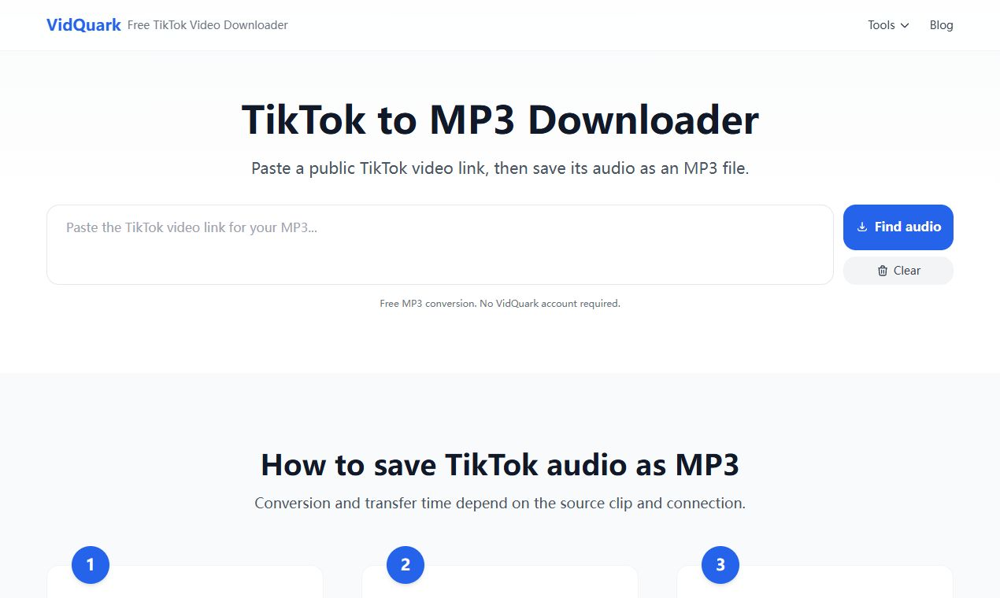

# VidQuark

Free browser-based TikTok MP4 downloads, MP3 audio conversion, and practical help finding saved files.

[Open VidQuark](https://vidquark.com/?utm_source=github&utm_medium=referral&utm_campaign=public_help_20261114) · [Download help](https://vidquark.com/faq) · [Report a problem](https://github.com/faxiangli/vidquark/issues/new/choose)

## Save a video or its audio

Use a public video you own or have permission to save. Available formats, resolution and watermarks depend on the source video.

1. Open the individual TikTok video and use **Share → Copy link**.
2. Paste the link into [TikTok Downloader](https://vidquark.com/tiktok-downloader?utm_source=github&utm_medium=referral&utm_campaign=public_help_20261114) and choose **Download**.
3. Check the result, then select **Download Video MP4** or **Download Audio MP3** when offered.
4. Keep the page open during transfer. When the file is ready, check your browser's Downloads list and play the completed file.

For audio, you can start with the dedicated [TikTok to MP3 tool](https://vidquark.com/tiktok-to-mp3?utm_source=github&utm_medium=referral&utm_campaign=public_help_20261114). Paste the video link and choose **Find audio**, then **Download Audio MP3**.

## Find your saved file

| Device | Where to start | Full guide |
| --- | --- | --- |
| iPhone or iPad | Safari Downloads and the Files app; check the download folder selected in your settings. | [iPhone file locations](https://vidquark.com/blog/download-tiktok-videos-on-iphone) |
| Android | Chrome's Downloads list or your phone's file manager. | [Android file locations](https://vidquark.com/blog/save-tiktok-videos-on-android) |
| Windows or Mac | Your browser's Downloads list; show the completed file in its folder. | [Desktop file locations](https://vidquark.com/blog/download-tiktok-on-pc-mac) |

An MP4 contains video and may include audio; an MP3 contains audio only. Renaming a file does not convert its contents. See the [MP4 playback and codec guide](https://vidquark.com/blog/tiktok-to-mp4-converter) or the [MP3 walkthrough](https://vidquark.com/blog/tiktok-mp3-downloader-extract-audio).

## Set an MP3 as your Android ringtone

Use a sound you own or have permission to save and use. Play the completed MP3 first to check its audio.

In **Files by Google**, open **Audio** under **Categories**, find and play the MP3, then choose **More → Set as ringtone**. Follow the permission prompt if Android displays one.

These assignment steps follow Google's Files by Google instructions. The VidQuark walkthrough also covers saving the MP3 and finding it in Chrome Downloads. [Google's ringtone instructions](https://support.google.com/files/answer/10018943?hl=en) · [Android ringtone walkthrough](https://vidquark.com/blog/tiktok-sound-android-ringtone?utm_source=github&utm_medium=referral&utm_campaign=android_ringtone_help_20261115)

## Get help with a failed download

Check that the original video is still publicly available, copy a fresh link, and follow any request-limit waiting message. If a transfer stops, check your connection and device storage. The [troubleshooting guide](https://vidquark.com/blog/tiktok-video-download-not-working) covers the main stages.

[Open a download problem report](https://github.com/faxiangli/vidquark/issues/new/choose) with your device, browser, the step that failed and the displayed error. Reports are public, so describe the problem without personal information. You can also suggest improvements through the Issues tab.

## About this repository

This repository is maintained for VidQuark usage help and public feedback. Website processing, analytics and third-party services are described in the [privacy policy](https://vidquark.com/privacy).

VidQuark is independent of TikTok and ByteDance. Downloading a file does not grant permission to publish or reuse someone else's content.
